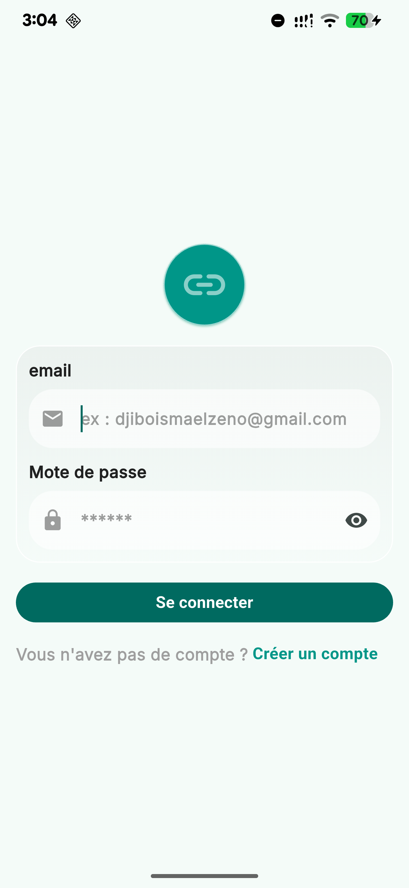
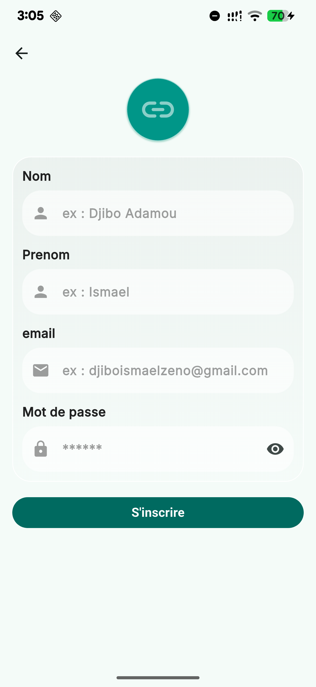
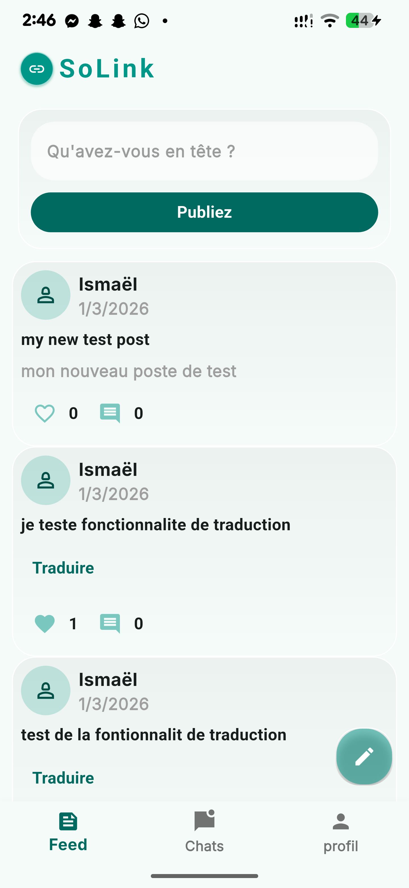
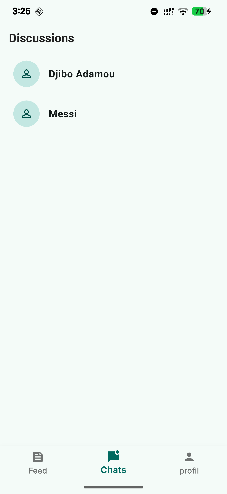
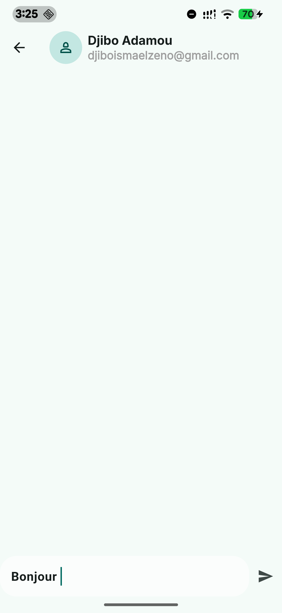
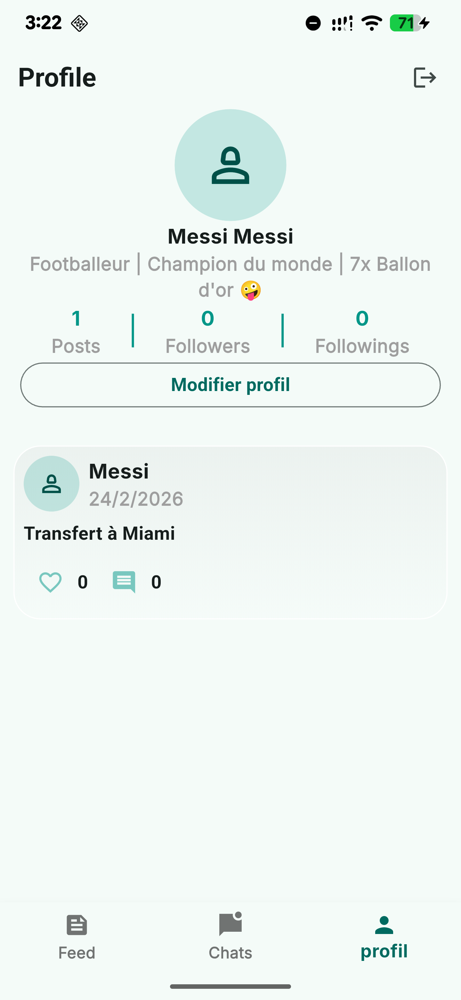
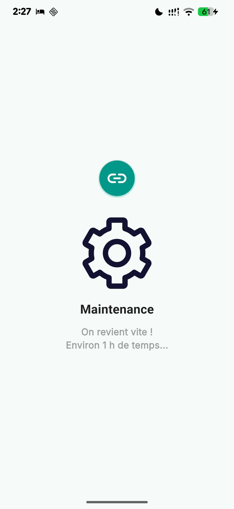
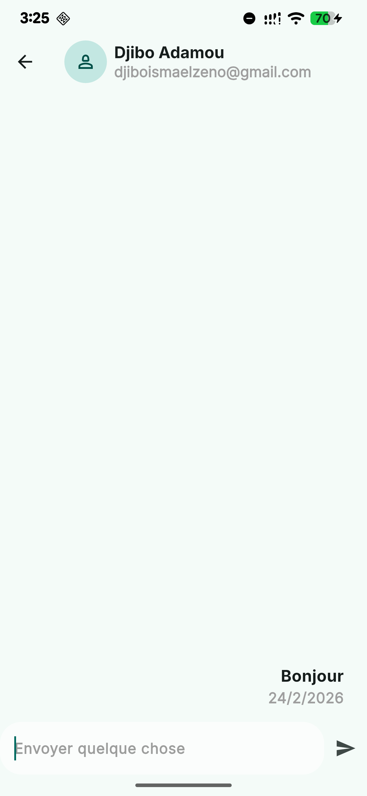
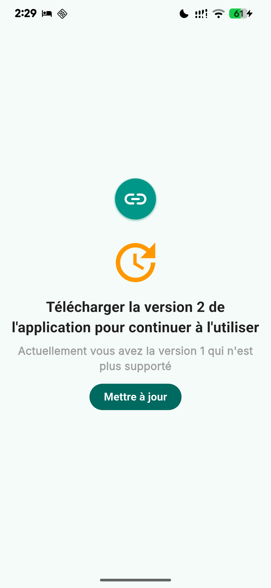

# Solink

**Réseau social minimaliste en temps réel — Flutter + Firebase**

[](https://github.com/Idjibo33/Solink/actions/workflows/flutter.yml)

Solink est une application mobile de réseau social : les utilisateurs publient des posts, échangent via des likes, des commentaires et une messagerie instantanée. Le projet intègre Firebase Auth, Cloud Firestore, Firebase Messaging, Remote Config, Firebase AI Logic et ML Kit (identification et traduction de langue).

## Fonctionnalités

- **Authentification :** inscription et connexion Email / mot de passe, onboarding.
- **Feed :** publications en temps réel (Firestore) et composition de posts.
- **Interactions :** likes et commentaires optimistes.
- **Messagerie :** conversations et chat en temps réel.
- **Profil :** profil utilisateur, édition de la bio, déconnexion.
- **Pilotage à distance :** maintenance et mise à jour forcée via **Firebase Remote Config**.
- **Traduction :** détection de langue et traduction des posts (**ML Kit**).
- **Génération de texte :** rédaction assistée par **IA** (Firebase AI Logic).

## Aperçu

| Connexion | Inscription | Onboarding | Feed |
|---|---|---|---|
|  |  |  |  |

| Discussions | Chat | Profil | Maintenance |
|---|---|---|---|
|  |  |  |  |

<details>
<summary>Voir plus de captures</summary>

| | | |
|---|---|---|
|  |  |  |
|  |  |  |
|  |  | |

</details>

## Stack technique

| Domaine | Technologie |
|---|---|
| Framework | Flutter / Dart |
| Backend | Firebase — Auth, Cloud Firestore, Messaging, Remote Config |
| IA & ML | Firebase AI Logic (`gemini-2.5-flash`), ML Kit |
| Architecture | Feature-first, couches data / domain / presentation |
| Gestion d'état | `flutter_bloc` (Bloc + Cubit), `equatable` |
| Erreurs | `fpdart` — `Either<Failure, T>` |
| Navigation | `go_router` (StatefulShellRoute) |
| Modèles | `json_serializable` + `build_runner` |
| UI | `google_fonts`, `lordicon`, `gap` |

## Architecture

```
lib/
├── main.dart                       # Firebase.initializeApp + composition root
├── app.dart                        # MultiRepositoryProvider / MultiBlocProvider / GoRouter
├── firebase_options.dart           # Configuration Firebase (clés Android/iOS via --dart-define)
├── core/
│   ├── constants/                  # Constantes applicatives
│   ├── di/                         # AppDependencies (injection manuelle) + BackendRegistry
│   ├── errors/                     # Failure sealed + codes d'erreur stables
│   ├── router/                     # GoRouter, redirects, AppShell
│   ├── theme/                      # Thème et styles partagés
│   ├── utils/                      # Dates, validateurs
│   └── widgets/                    # Composants UI réutilisables
└── features/
    ├── auth/                       # data / domain / presentation
    ├── posts/                      # Feed, composer, commentaires
    ├── chats/                      # Conversations, chat
    ├── profile/
    ├── settings/                   # Remote Config, splash, maintenance, update
    ├── translation/                # ML Kit
    └── ai/                         # Firebase AI Logic
```

Chaque feature suit le même découpage :

- `data/` : modèles, adaptateurs de backend, implémentations des repositories.
- `domain/` : ports (interfaces) et modèles métier.
- `presentation/` : écrans, widgets, Bloc/Cubit.

### Choix du backend de données

Le stockage et l'authentification sont accessibles via des **ports** (interfaces)
déclarés dans `domain/`. Les implémentations concrètes vivent dans `data/` et
sont rangées par fournisseur :

```
lib/features/<feature>/data/
├── <backend>/        # ex. firestore/ : adaptateurs d'un fournisseur
│   ├── firestore_post_store.dart
│   └── ...
└── repositories/     # implémentations des repositories (agnostiques)
```

Ports disponibles :

| Port | Rôle |
| --- | --- |
| `AuthGateway` | Connexion, inscription, session, déconnexion |
| `UserStore` | Profils publics et données privées |
| `PostStore` | Posts, commentaires, likes |
| `ChatStore` | Conversations et messages |

Le choix du backend se fait à la compilation, dans un seul endroit
(`lib/core/di/backend_registry.dart`) :

```bash
flutter run --dart-define=BACKEND=firebase
```

Pour brancher un nouveau fournisseur :

1. écrire les adaptateurs dans `lib/features/<feature>/data/<backend>/` ;
2. les enregistrer dans `BackendRegistry.resolve` ;
3. ajouter une valeur à `BackendSelection`.

Les modèles ne dépendent d'aucun SDK : ils stockent des `DateTime` et chaque
adaptateur traduit ce format vers le sien (timestamp Firestore, ISO-8601,
epoch...). Les erreurs sont traduites en `AppException` portant un code stable
(`ErrorCodes`), ce qui garde les messages utilisateur indépendants du fournisseur.

> Les services Firebase IA, Remote Config et notifications restent branchés
> directement : ils ne font pas partie du stockage ni de l'identité.

## Modèle Firestore

| Collection | Contenu |
|---|---|
| `users/{uid}` | Profil public : `id`, `nom`, `prenom`, `bio`, `posts`, `followers`, `followings`, `creeLe`. **Aucun e-mail.** |
| `users_private/{uid}` | Données privées : `id`, `email`, `creeLe`. Lecture réservée au propriétaire. |
| `posts/{postId}` | `userId`, `userName`, `content`, `likes`, `comments`, `creeLe`. |
| `posts/{postId}/comments/{commentId}` | `userId`, `userName`, `content`, `creeLe`. |
| `chatrooms/{roomId}` | `membres` (triés), `dernierMessage`, `dernierEnvoi`. |
| `chatrooms/{roomId}/messages/{messageId}` | `senderId`, `content`, `envoyeLe`. |

Un index composite (`posts.userId` + `posts.creeLe`) est déclaré dans `firestore.indexes.json` pour les profils.

## Installation

Prérequis : Flutter stable, un projet Firebase avec Auth Email/Mot de passe, Firestore, Remote Config et Firebase AI Logic activés.

```bash
flutter pub get

# 1. Créer le fichier .env à la racine à partir du modèle
cp .env.example .env
#    puis renseigner AndroidApiKey et IosApiKey (Firebase > Paramètres du projet)

# 2. Lancer l'application en injectant les clés au build
flutter run --dart-define-from-file=.env

# 3. Régénérer les modèles après modification des annotations
dart run build_runner build --delete-conflicting-outputs
```

> Les clés Android/iOS sont lues avec `String.fromEnvironment` : aucun secret n'est
> embarqué dans le dépôt. Sans `--dart-define`, l'application compile mais Firebase
> ne peut pas démarrer sur Android/iOS.
>
> La clé web Firebase reste dans `lib/firebase_options.dart` (identifiant client public) ;
> la sécurité repose sur les règles Firestore/Storage.

## Règles Firebase

Les règles sont versionnées et référencées dans `firebase.json`. Points importants :

- Les profils `users` sont lisibles par tout utilisateur connecté, sans e-mail.
- Les e-mails sont isolés dans `users_private`, accessibles uniquement à leur propriétaire.
- Les likes utilisent des opérations ensemblistes (`arrayUnion` / `arrayRemove`) validées côté règles.
- Le compteur `comments` ne peut être incrémenté que de 1 par commentaire.
- Les messages d'un chat sont réservés aux membres de la room.

> Les comptes historiques peuvent encore contenir `email` dans `users/{uid}`
> tant que la migration décrite ci-dessous n'a pas été exécutée.

### Valider les règles en local

Prérequis : **Node.js 24+**, `firebase-tools` et **Java 21** (requis par
l'émulateur Firestore).

```bash
cd tool
npm install
npm run test:rules
```

`firebase-tools` est installé localement dans `tool/node_modules` ; aucune
installation globale n'est nécessaire.

Le script démarre l'émulateur Firestore sur le projet `demo-solink` et exécute
`firestore_rules_test.mjs` (profils, e-mails privés, likes, commentaires, posts,
chat et migration de l'e-mail historique).

### Déployer les règles

```bash
firebase login
firebase deploy --project nomadvoyage-2025 \
  --only firestore:rules,firestore:indexes,storage
```

## Données simulées (émulateur local)

Le script `tool/seed_firestore.mjs` remplit l'émulateur Firestore local avec un
jeu de données réaliste : profils, posts, commentaires, likes et conversations.
Il crée aussi les comptes Firebase Auth correspondants, ce qui permet de se
connecter à l'application avec un profil simulé.

### 1. Démarrer les émulateurs

Prérequis : **Node.js 24+**, `firebase-tools` et **Java 21**.

```bash
cd tool
npm install
npm run emulators
```

Firestore écoute sur `127.0.0.1:8080`, Auth sur `127.0.0.1:9099` et l'UI
Firebase est disponible sur <http://127.0.0.1:4000>.

### 2. Injecter les données

```bash
cd tool
npm run seed
```

Le seed supprime les données existantes puis réécrit le jeu complet. Le tirage
est déterministe : deux exécutions produisent les mêmes profils.

Options disponibles :

| Option | Défaut | Rôle |
| --- | --- | --- |
| `--users=N` | `10` | Nombre de profils simulés |
| `--posts=N` | `30` | Nombre de posts dans le feed |
| `--comments-per-post=N` | `2` | Nombre maximal de commentaires par post |
| `--password=...` | `SolinkTest123` | Mot de passe commun des comptes |
| `--keep` | désactivé | Conserve les données existantes au lieu de nettoyer |
| `--simple-emails` | désactivé | Génère des adresses `user1@solink.test` faciles à saisir à la main |

### 3. Lancer l'application sur l'émulateur

```bash
flutter run --dart-define=USE_FIREBASE_EMULATORS=true \
            --dart-define=FIREBASE_EMULATOR_HOST=<hôte> \
            --dart-define=AndroidApiKey=<clé>
```

`USE_FIREBASE_EMULATORS` bascule `FirebaseAuth` et `FirebaseFirestore` vers les
émulateurs locaux. La variable est absente par défaut : un build de production
ne touche jamais l'émulateur.

`FIREBASE_EMULATOR_HOST` indique où joindre les émulateurs :

| Contexte | Valeur | Commande |
| --- | --- | --- |
| Émulateur Android (AVD) | `10.0.2.2` | `--dart-define=FIREBASE_EMULATOR_HOST=10.0.2.2` |
| Appareil physique en USB | `127.0.0.1` | `adb reverse tcp:8080 tcp:8080` et `adb reverse tcp:9099 tcp:9099` |
| Appareil physique en Wi-Fi | IP de la machine | `--dart-define=FIREBASE_EMULATOR_HOST=192.168.1.10` |

> Sur Android, le SDK redirige `127.0.0.1` vers `10.0.2.2`. Cette valeur
> n'existe que sur un AVD : sur un appareil physique, utilisez l'IP de la
> machine ou `adb reverse`.

### 4. Se connecter

Le script affiche les comptes créés. Tous partagent le même mot de passe :

```
awa.koffi1@solink.test  |  SolinkTest123  |  Awa Koffi
```

> Le clavier Android complète automatiquement les adresses contenant un point.
> Utilisez `--simple-emails` pour générer des adresses `user1@solink.test`
> faciles à saisir à la main.

### 5. Tests d'intégration

Le test `integration_test/firestore_backend_test.dart` valide la chaîne
complète (SDK Firebase → adaptateur → repository) sur un appareil réel :

```bash
cd tool && npm run emulators          # dans un terminal
flutter test integration_test/firestore_backend_test.dart \
  -d <device> --dart-define=EMULATOR_HOST=<hôte>
```

### Collections générées

| Collection | Contenu |
| --- | --- |
| `users` | Profils publics (`id`, `nom`, `prenom`, `bio`, compteurs) |
| `users_private` | E-mails, lisibles uniquement par le propriétaire |
| `posts` | Posts du feed avec `likes` et compteur `comments` |
| `posts/{id}/comments` | Commentaires imbriqués |
| `chatrooms` | Conversations (`members`, `lastMessage`) |
| `chatrooms/{id}/messages` | Messages imbriqués |

> Les données simulées respectent les règles de sécurité : chaque profil ne
> voit que les conversations dont il est membre, et chaque e-mail privé reste
> inaccessible aux autres comptes.

## Migration des e-mails historiques

Les anciens comptes peuvent encore avoir un champ `email` dans `users/{uid}`.
Deux mécanismes le suppriment au profit de `users_private/{uid}` :

1. **À la connexion** : `UserStore.migrateLegacyEmail` copie l'e-mail dans
   `users_private` puis retire le champ du profil public (transaction idempotente).
2. **Pour tous les comptes** : script admin `tool/migrate_user_emails.mjs`, qui
   contourne les règles via le SDK Admin.

Créer un compte de service Firebase (`Cloud Datastore User` ou `Firebase Admin`),
puis lancer d'abord un dry-run :

```bash
cd tool
npm install
GOOGLE_APPLICATION_CREDENTIALS=/chemin/serviceAccount.json \
  DRY_RUN=true npm run migrate:emails
```

Puis l'exécution réelle :

```bash
GOOGLE_APPLICATION_CREDENTIALS=/chemin/serviceAccount.json npm run migrate:emails
```

Ne jamais committer le fichier de compte de service.

## Signature Android

Pour produire un APK/AAB release signé, créer `android/key.properties` (ignoré par Git) :

```properties
storePassword=...
keyPassword=...
keyAlias=...
storeFile=/chemin/absolu/vers/keystore.jks
```

Sans ce fichier, le build release Android échoue explicitement : aucune release ne
peut être produite avec la signature debug.

L'`applicationId` et le `namespace` Android sont désormais `com.idjibo33.solink`.
Le changement d'`applicationId` impose de réenregistrer l'application Android dans
Firebase et de remplacer `android/app/google-services.json` :

```bash
firebase apps:create ANDROID SoLink \
  --package-name com.idjibo33.solink \
  --project nomadvoyage-2025

# Récupérer l'App ID affiché, puis :
firebase apps:sdkconfig ANDROID <APP_ID> \
  --project nomadvoyage-2025 -o android/app/google-services.json

# Mettre aussi à jour firebase_options.dart (appId Android)
flutterfire configure --project nomadvoyage-2025
```

L'ancienne application Firebase `com.example.so_link` a été supprimée : seul le
client `com.idjibo33.solink` reste dans `google-services.json`.

## Configuration iOS

Le bundle iOS est aligné sur Android : `com.idjibo33.solink`, avec une cible
minimum iOS 15.0 (requise par Firebase). L'application Firebase iOS correspondante
a été recréée avec l'appId
`1:1094348719183:ios:c7072efc2063b51eca163a` ; l'ancienne app
`com.example.soLink` a été supprimée.

Le fichier `ios/Runner/GoogleService-Info.plist` n'est pas versionné : Firebase
est initialisé via `firebase_options.dart` et la clé iOS vient de
`IosApiKey` injectée au build. Si vous générez le plist localement, il reste
ignoré par Git.

La release iOS nécessite macOS, Xcode, CocoaPods, un compte Apple Developer,
un certificat et un profil de provisioning associés à
`com.idjibo33.solink`. Au premier build sur macOS, `pod install` génère
`ios/Podfile.lock` : le committer pour figer les versions des pods. Pour
`firebase_messaging`, activer la capability Push Notifications et configurer la
clé APNs dans Firebase avant de publier.

Commandes de release, une fois la signature configurée :

```bash
flutter build appbundle --release --dart-define-from-file=.env
flutter build ipa --release --dart-define-from-file=.env
```

## Tests

```bash
flutter analyze
flutter test
```

La suite couvre les Cubits/Blocs (auth, feed, composer, commentaires, chat, config),
les modèles JSON, les validateurs et les parcours UI (connexion, inscription,
onboarding, feed) via des dépôts simulés.

Pour exécuter le parcours sur un appareil ou un émulateur Android :

```bash
flutter drive \
  --driver=test_driver/integration_test.dart \
  --target=integration_test/app_test.dart \
  -d <device-id>
```

Le même scénario est rejoué par `flutter test` via
`test/integration_app_flow_test.dart`, sans appareil.

## Licence

[MIT](LICENSE)
